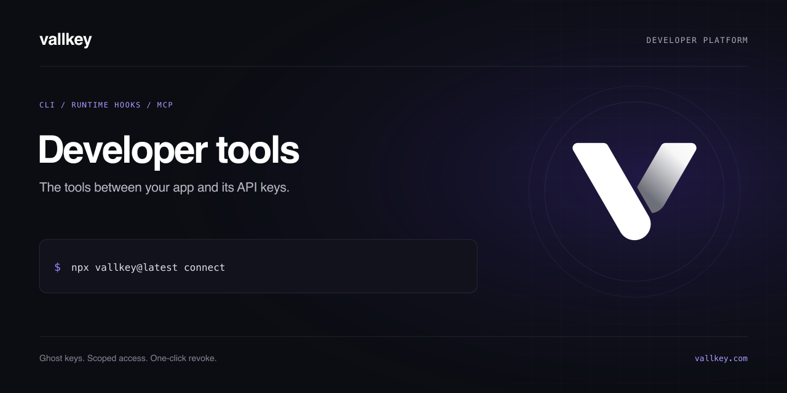

[](https://github.com/vallkeyhq/developer-tools/actions/workflows/checks.yml)
[](https://github.com/vallkeyhq/developer-tools/actions/workflows/secrets.yml)
[](LICENSE)

# Vallkey developer tools

The command-line tool and runtime integrations for [Vallkey](https://vallkey.com). Ghost keys replace provider credentials in your application; the hosted gateway applies their permissions and usage limits before forwarding requests.

## Start with the CLI

Use Node.js 18 or later. A current supported Node.js LTS release is recommended.

```sh
npx vallkey@latest login
npx vallkey@latest init --dry-run
npx vallkey@latest connect
```

Review the preview before running `init` without `--dry-run`: it creates ghost keys and updates the selected environment files. Keep any original credentials you still need in your secret manager.

## Components

| Component                                  | Source and documentation             | Integration                                                       |
| ------------------------------------------ | ------------------------------------ | ----------------------------------------------------------------- |
| CLI, MCP server, JavaScript session helper | [cli](cli/README.md)                 | Management commands, local key scanning, server-side session keys |
| Node.js and Bun hook                       | [cli/src/auto.cts](cli/src/auto.cts) | Global `fetch` and exported Node `http`/`https` functions         |
| Python                                     | [python](python/README.md)           | Supported Python HTTP transports and server-side session keys     |
| Ruby                                       | [ruby](ruby/README.md)               | `Net::HTTP`                                                       |
| Java                                       | [java](java/README.md)               | Java agent for supported JDK, OkHttp and Apache HTTP clients      |
| .NET                                       | [dotnet](dotnet/README.md)           | `HttpClient` diagnostics hook                                     |
| PHP                                        | [php](php/README.md)                 | PHP cURL extension hook                                           |
| Elixir and Erlang                          | [elixir](elixir/README.md)           | Finch, hackney and httpc entry points                             |
| Examples                                   | [examples](examples/README.md)       | Read-only requests with ghost keys                                |

Auto-connect coverage depends on the transport and runtime. It does not cover every SDK or protect requests that still use a real provider credential directly. Read the [compatibility and security boundaries](docs/compatibility.md) before deploying.

## Design

The CLI and Node/Bun integration are authored in strict TypeScript. Builds produce ESM commands, CommonJS preload hooks and type declarations, preserving the Node.js installation contract. Read the [architecture](docs/architecture.md), [compatibility boundaries](docs/compatibility.md) and [release process](docs/releases.md).

## Development

```sh
npm ci
npm run typecheck
npm test
npm run check
npm run check:artifacts
npm run scan
```

The CLI has no runtime dependencies. Other language tests use local mock servers and their own toolchains. See [CONTRIBUTING.md](CONTRIBUTING.md) for commands, and [docs/releases.md](docs/releases.md) for package and artifact releases.

This repository contains client tools. The hosted gateway and dashboard are maintained separately. Running these tools does not self-host the Vallkey service. The scanner runs locally without a Vallkey account; management commands and protected requests require a reachable Vallkey API and appropriate credentials.

## Support and licensing

Use issues for reproducible tooling bugs and [Vallkey support](https://vallkey.com/contact/) for account questions. Report vulnerabilities privately as described in [SECURITY.md](SECURITY.md).

Vallkey source in this repository is licensed under [MIT](LICENSE). Bundled dependencies retain their own licenses; see [THIRD_PARTY_NOTICES.md](THIRD_PARTY_NOTICES.md). The license does not grant rights to Vallkey or provider trademarks.
