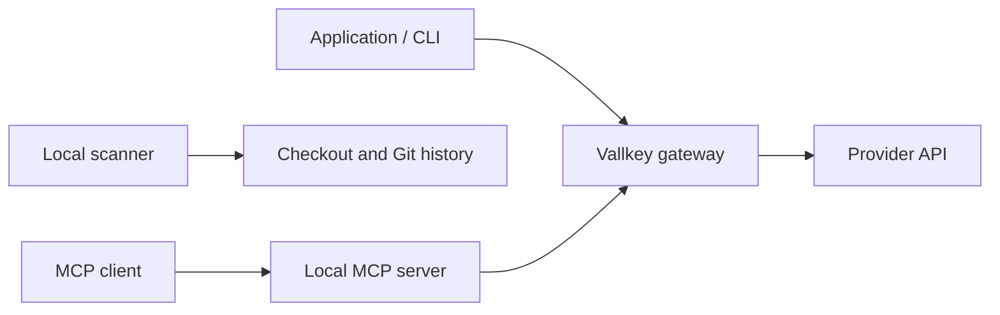

# Architecture

## Source and distribution

`cli/src/` contains the command router, management API client, environment-file editor, scanner, MCP server and runtime integration. `cli/bin/vallkey.ts` is the command entry point. `cli/src/types.ts` describes the management contract; externally supplied configuration, JSON-RPC envelopes and gateway origins are validated at runtime.

The TypeScript compiler runs with strict checking, unused-code checks and declaration output. There are no `any` annotations or type-check suppression directives in the runtime source. Tests run through `tsx` against compiled code so child processes exercise the actual distributed JavaScript rather than TypeScript loader behavior.

| Source                | Built artifact                          | Consumer                                                       |
| --------------------- | --------------------------------------- | -------------------------------------------------------------- |
| `cli/bin/vallkey.ts`  | `dist/bin/vallkey.js`                   | npm executable                                                 |
| `cli/src/**/*.ts`     | `dist/src/**/*.js` and declarations     | ESM command implementation                                     |
| `cli/src/auto.cts`    | `dist/src/auto.cjs`                     | `require('vallkey/auto')`, preload and ESM side-effect imports |
| `cli/src/session.cts` | `dist/src/session.cjs` and declarations | Server-side session helper                                     |
| `cli/src/hooks.json`  | `dist/src/hooks.json`                   | Native installer’s versioned checksum manifest                 |

JavaScript is a build output; it is not a second maintained source tree. Node.js 18 remains the minimum runtime. TypeScript and the test runner are development dependencies and are not required to execute an installed package.

## Trust boundaries

The scanner runs locally without a Vallkey account. Management commands authenticate to the configured gateway. Saved tokens are scoped to their saved API origin; changing the gateway does not reuse that token. Management and session requests reject redirects.

The hook detects recognized ghost credentials in supported transports. It changes routing, not provider policy. The hosted gateway enforces permissions and replaces credentials; see [compatibility.md](compatibility.md) for unsupported transports and initialization behavior.

MCP owner tools read credentials from local files and return key IDs. Selected paths are constrained to the canonical project directory, including symlink resolution. This check does not make concurrent filesystem changes safe; run the MCP server only against a trusted local checkout. Agent task keys remain in process memory unless explicit disclosure is requested.

## Validation

`npm run typecheck` checks the runtime, build scripts and example source. `npm test` builds and runs unit and integration tests against the compiled CLI. `npm run check:package` verifies the packed executable, CommonJS/ESM exports and TypeScript consumer declarations in an isolated installation.

Public native-language tests use local mock servers. Private gateway verification and live provider account tests remain separate layers; neither is implied by a successful local interception test.
