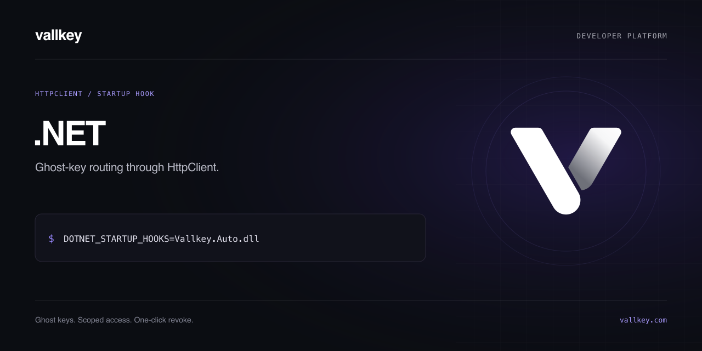

# Vallkey.Auto (.NET)

Route ghost-key requests through [Vallkey](https://vallkey.com) using the supported HTTP clients below. Requests that carry a ghost key go to Vallkey, which swaps in the real key under your rules. Every other request is left alone.

```sh
DOTNET_STARTUP_HOOKS=/path/to/Vallkey.Auto.dll dotnet MyApp.dll
```

Works on .NET 8 and later, for the supported `HttpClient` diagnostic request event (OpenAI, Anthropic, Stripe, Twilio, AWS, SendGrid…). Apps published as native AOT or trimmed cannot use auto-connect.

| Setting           | What it does                                           |
| ----------------- | ------------------------------------------------------ |
| `VALLKEY_API`     | The Vallkey server (default `https://api.vallkey.com`) |
| `VALLKEY_AUTO=0`  | Turns it off                                           |
| `VALLKEY_DEBUG=1` | Logs each request sent to Vallkey (never the key)      |

## Compatibility and security

Read the [transport boundaries](https://github.com/vallkeyhq/developer-tools/blob/main/docs/compatibility.md) and [security policy](../SECURITY.md). Local transport tests do not certify every SDK version or cloud deployment. Use a dedicated key and verify requests from the actual application after deployment.
